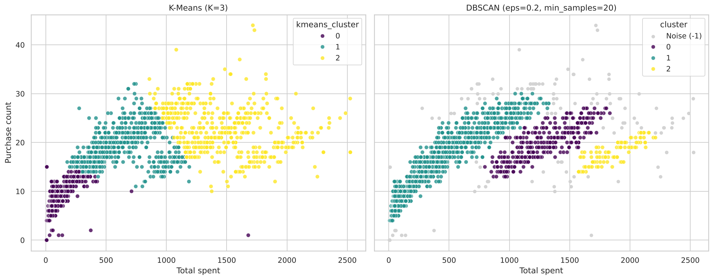

# Customer Segmentation: K-Means vs DBSCAN

Unsupervised machine learning project that segments 2,240 retail customers by their spending behaviour and compares two clustering algorithms, **K-Means** and **DBSCAN**, on the same data and the same evaluation rules.

**Tech stack:** Python, Pandas, NumPy, Scikit-learn, Matplotlib, Seaborn, Jupyter

## Project Overview

| | |
|---|---|
| **Goal** | Group customers into meaningful segments and decide which algorithm suits the task better |
| **Data** | 2,240 customers, 29 columns (demographics, spending per product category, purchases per channel, campaign responses) |
| **Features used** | `total_spent` (sum of all `Mnt*` columns) and `purchase_count` (sum of deals, web, catalog and store purchases) |
| **Preprocessing** | Missing `Income` (24 rows) filled with the median; features standardized with `StandardScaler` |
| **Models** | K-Means (K = 3) and DBSCAN (`eps = 0.2`, `min_samples = 20`) |

## Results

| Model | Clusters | Noise | Largest cluster | Silhouette (same non-noise points) |
|---|---|---|---|---|
| K-Means (K=3) | 3 | 0 % | 45.0 % | **0.553** |
| DBSCAN (eps=0.2, min_samples=20) | 3 | 5.8 % | 73.2 % | 0.345 |

K-Means silhouette on all 2,240 customers is 0.533. DBSCAN's silhouette can only be computed on non-noise points, so the table compares both models on exactly the same points.



### K-Means segments

| Segment | Customers | Share | Avg total spent | Avg purchases | Avg income |
|---|---|---|---|---|---|
| Budget | 1,007 | 45.0 % | 91 | 7.6 | 35,739 |
| Regular | 659 | 29.4 % | 641 | 19.2 | 58,168 |
| Premium | 574 | 25.6 % | 1,468 | 22.7 | 74,375 |

### Key findings

- **K-Means is the better fit for segmentation.** It assigns every customer and gives three clearly different spending tiers.
- **DBSCAN struggles on this data.** 73 % of customers land in one cluster because spending and purchase frequency change continuously, with no empty gap between customer types.
- **DBSCAN works well as an outlier detector.** The 131 customers it flags as noise are mostly high-spend, high-purchase customers (average spend 1,334 and 23.5 purchases, versus 606 and 14.9 overall).
- The two clusterings agree only weakly (Adjusted Rand Index = 0.29), so the algorithm choice changes which customers end up together.

## Methodology Notes

- **Why K = 3 and not 2?** Silhouette alone prefers K = 2 (0.607, a simple low/high split). K = 3 (0.533) was chosen on purpose because three tiers are more useful for marketing. This is a business decision, not the statistical optimum.
- **Avoiding a misleading DBSCAN score.** Silhouette ignores noise points, so a tiny `eps` can score very high just by labelling most customers as noise (e.g. `eps = 0.05` reaches 0.74 with 68 % noise). The grid search therefore only accepts candidates with **noise <= 10 %** and **2 to 10 clusters**.
- **One scaler for everything**, so the algorithms are compared on identical inputs.
- **Predicting new customers.** K-Means uses `predict()`. DBSCAN has none, so a new point joins the cluster of its nearest core point if it is within `eps`, otherwise it is labelled noise.

## Repository Structure

```
.
├── data/
│   └── customer_segmentation.csv
├── notebooks/
│   ├── 01_kmeans.ipynb            # K selection, final model, segment profiles, prediction
│   ├── 02_dbscan.ipynb            # k-distance plot, parameter search, profiles, prediction
│   └── 03_kmeans_vs_dbscan.ipynb  # side-by-side comparison and conclusions
├── images/                        # figures used in this README
├── requirements.txt
└── README.md
```

## How to Run

```bash
git clone <your-repo-url>
cd <your-repo-folder>
pip install -r requirements.txt
jupyter notebook
```

Open the notebooks in order (01, 02, 03) and run all cells. Each notebook is self-contained and reads the data from `../data/`.

Tested with Python 3, scikit-learn 1.9, pandas 3.0, NumPy 2.5, Matplotlib 3.11 and seaborn 0.13.

## Limitations and Next Steps

- Only two features are used, and they are strongly correlated (r = 0.75). Adding income, recency, campaign response or product mix could give richer segments.
- Try other algorithms (Gaussian Mixture, hierarchical clustering) and PCA for visualizing more features.
- Validate segments against a business outcome (e.g. campaign response rate) rather than silhouette alone.

## Author

**Mohamed Tarek** · [LinkedIn](https://linkedin.com/in/mohamedtarek2412) · [GitHub](https://github.com/MohamedTarek2412)
